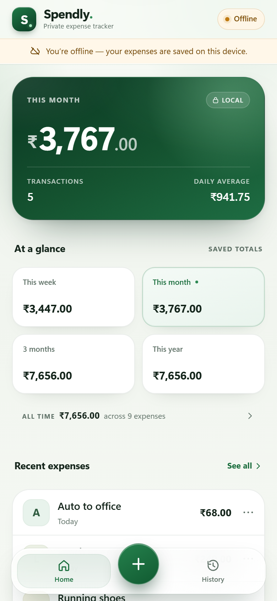

# Spendly

A private, offline-first expense tracker built with plain HTML, CSS and JavaScript. No build step, no account, no backend, no API keys.

<p align="center">
  
  
  
</p>

<p align="center"><em>Sample data shown. The interface is designed for iPhone and also works on desktop.</em></p>

## What changed in this version

- **IndexedDB is now the primary storage.** Expenses are validated, saved and read through a repository layer, not directly from the interface.
- **Existing records migrate automatically.** Expenses stored by older releases under `spendly_expenses_v1` in `localStorage` are imported once, verified, and never deleted from the original key.
- **Reliable offline app shell.** A versioned service worker precaches the HTML, CSS, JavaScript, manifest and icons, serves the shell offline, and cleans up old caches on activation.
- **The interface was redesigned** around Apple's Liquid Glass material language: translucent floating navigation and sheets, layered depth, refined typography, and a forest-green identity. Readable data surfaces stay opaque.
- **All existing features are preserved:** weekly/monthly/three-month/yearly totals, recent expenses, full searchable history, editing, deletion, CSV export, JSON backup and restore.
- **Connectivity is visible** without claiming any cloud sync, because there is none.

## Features

- Add, edit and delete expenses with Indian Rupee formatting (`en-IN`, ₹).
- Weekly total from Monday to Sunday, current month, rolling three calendar months, current year, all-time total and transaction count.
- Daily average for the selected period, based on elapsed calendar days.
- Five most recent expenses, month-grouped history with subtotals, and search across description, date, month and amount.
- Undo after deleting an expense.
- CSV export, JSON backup, and validated backup restore with an automatic safety copy and undo.
- Installable PWA with offline launch, iPhone Home Screen support and app shortcuts.
- Local-first: all expenses stay in the browser for this site address.

## Project structure

```text
Spendly/
├── index.html                 # App shell, accessible markup and SVG icon sprite
├── css/
│   └── app.css                # Liquid Glass design system and responsive layout
├── js/
│   ├── core.js                # Pure date, money, validation, search and summary rules
│   ├── db.js                  # The only IndexedDB adapter (stores and indexes)
│   ├── repository.js          # Expense repository, timestamps, validation, migration
│   └── app.js                 # UI rendering and interaction (never touches IndexedDB)
├── sw.js                      # Precache + offline shell + safe update flow
├── manifest.json              # PWA metadata, icons and shortcuts
├── netlify.toml               # Static publish config and cache/security headers
├── icons/                     # App icons (180, 192, 512, maskable)
├── screenshots/               # Documentation screenshots
├── tests/
│   ├── server.mjs             # Zero-dependency local static server
│   ├── e2e.mjs                # Playwright browser suite
│   └── unit/
│       ├── core.test.mjs
│       └── repository.test.mjs
├── package.json               # Test scripts only; the app needs no dependencies
├── .gitignore
└── README.md
```

## Running the project locally

The app is static, but it uses ES modules and a service worker. **Do not open `index.html` by double-clicking it** — open it through a local web server.

### Fastest option (Node.js 20+)

```bash
npm start
```

Then open **http://localhost:4173**. The included server has no dependencies and serves the project with the correct MIME types. A service worker is allowed on `localhost`, so offline testing works here.

### VS Code / Live Server

1. Open the `Spendly` folder in VS Code.
2. Install the **Live Server** extension (Ritwick Dey), if needed.
3. Right-click `index.html` → **Open with Live Server**.
4. Open the address it prints, usually `http://127.0.0.1:5500`.

For installation on an actual iPhone, the site must be served over **HTTPS** (Netlify does this) or from `localhost` on a computer.

## Testing

### Unit tests (no install needed)

```bash
npm test
```

This runs 29 tests covering calendar bounds, Monday-start weeks, rolling three-month windows, leap/real-date validation, money parsing, search, month grouping, stable ordering, legacy ID timestamps, migration idempotency, duplicate handling, verification failure and atomic replacement.

### Browser end-to-end tests

One-time setup:

```bash
npm install
npx playwright install chromium
```

Run:

```bash
npm run test:e2e
```

The suite starts its own server and verifies:

1. Existing `localStorage` expenses migrate once, keep their ids/timestamps, and survive a reload without duplicates.
2. Add, edit, delete, undo, search, CSV export, JSON backup, invalid restore rejection and valid restore with undo.
3. The service worker caches every shell asset; the app relaunches offline, then adds/edits/deletes/searches/exports/restores offline, and reopens in a new tab while still offline.
4. Expenses and the cached app shell survive a **full browser restart** using a persistent browser profile, including an offline reload afterwards.
5. The iPhone install hint appears and stays dismissed after reload.
6. Layouts at 320 px mobile, 390 px mobile and 1440 px desktop, without horizontal overflow.
7. Screenshots are regenerated in `screenshots/`.

The run finishes with a pass/fail summary and fails if the browser console reports an error. Temporary test files go to `test-results/` (ignored by Git).

### Manual testing checklist

Automation cannot cover real iOS behaviour. Before shipping, check:

- [ ] Install the previous release with a few real expenses, download a backup, deploy this version, then open it. Confirm every expense is present, totals match, and no duplicates appear after two reloads.
- [ ] In DevTools → Application → Storage, confirm `spendly_expenses_v1` still exists after migration and the `spendly` IndexedDB database contains the records.
- [ ] Go offline (DevTools → Network → Offline) after one online load. Reload, add, edit, delete, search, export CSV, download a backup and restore it. Close the tab and reopen it while still offline.
- [ ] On an iPhone in Safari, tap **Share → Add to Home Screen**, open Spendly from the icon, and check the notch/Dynamic Island spacing and bottom safe area.
- [ ] In standalone mode, open the add-expense sheet with the keyboard visible, switch dates, save, and confirm the dock and sheet do not overlap important controls.
- [ ] Test VoiceOver labels for Home/History, period tiles, expense rows, the more-actions button and sheet fields.
- [ ] Enable Reduce Motion and Reduce Transparency in iOS Accessibility settings and confirm the app remains usable without blur or animation.
- [ ] Test text at a large accessibility size (or 200% browser zoom) and confirm no controls are clipped.
- [ ] Deploy an update with a bumped cache version and confirm the “new version is ready” banner appears, then Refresh applies it.
- [ ] Try CSV/JSON downloads in iOS Safari and confirm they can be saved to Files; test restoring the JSON through the file picker.

## Offline behaviour

The service worker (`sw.js`) precaches the app shell during install:

- `index.html`, `css/app.css`, all JS modules, `manifest.json` and all icons.
- Navigation requests are answered from the cached shell, so the HTML always matches the cached JS/CSS generation.
- Local static assets are served cache-first; unknown same-origin GETs fall back to the network and are cached when successful.
- Cross-origin requests and non-GET requests are not intercepted.
- A new service worker waits instead of taking over immediately. Spendly shows a **Refresh** banner, then the new worker activates and old `spendly-*` caches are deleted.
- The service worker never opens IndexedDB. Updating the app therefore cannot erase expenses.

**When you change any cached asset (HTML, CSS, JS, manifest, icons), bump `CACHE_VERSION` in `sw.js`.** For example, `v3` → `v4`. Netlify already serves `sw.js` with `Cache-Control: no-cache`.

Offline use requires **one successful online load first**, over HTTPS or localhost. After that, the app and its local data work without a connection.

## Connectivity indicator

- Online after the app shell is installed: a subtle green dot with **Available offline**.
- Online before the shell is ready: **On this device**.
- Offline: an amber **Offline** pill plus a banner reading **“You’re offline — your expenses are saved on this device.”**
- Returning online updates the indicator automatically and briefly confirms that expenses are still stored locally. There is no cloud sync, so no message claims otherwise.

## Where expense data is stored

- **Primary storage:** IndexedDB database `spendly`, version 1.
  - Object store `expenses`, keyed by a stable `id`, with indexes on `date`, `createdAt`, and `[date, createdAt]`.
  - Object store `meta`, keyed by `key`, used for the migration completion marker.
- **Record shape:**

```json
{
  "id": "8d0d5e4a-…",
  "amount": 240,
  "description": "Lunch",
  "date": "2026-11-04",
  "createdAt": "2026-11-04T08:20:00.000Z",
  "updatedAt": "2026-11-04T08:20:00.000Z"
}
```

- **Legacy storage:** `localStorage["spendly_expenses_v1"]`. It is read during migration and deliberately **left untouched**. The original data stays available in the browser even after migration.
- **Small UI preferences** (such as the dismissed install tip) use separate `localStorage` keys; they are not expense data.
- **Origin and browser:** data belongs to the exact site origin (for example `https://spendly.netlify.app`) in the exact browser/device where it was entered. It does not follow you to another browser, phone or custom domain.

### Automatic migration

On startup, before the UI renders:

1. Spendly checks for a completed migration marker in IndexedDB. If present, it stops.
2. Otherwise it reads `spendly_expenses_v1`, parses and validates each record against the real schema.
3. Record ids are preserved, and `createdAt` is recovered from the original timestamp-based id where possible (or from the expense date).
4. Missing ids are only generated for imported backups, never for normal records.
5. Records are written with `put` semantics by id, so a repeated run cannot duplicate them. Existing IndexedDB records win over an older copy in `localStorage`.
6. Spendly reads the records back and verifies every id exists before writing the `migration:localStorage:v1` completion marker.
7. If verification fails, the marker is not written, the original data remains, and the app continues with whatever is already in IndexedDB.

There is also a recovery benefit: if IndexedDB is cleared but `localStorage` remains, the next load attempts a fresh migration.

## Exporting and restoring backups

Open **History → Your data**.

- **Export CSV** downloads a spreadsheet-friendly file with the date, description and amount in INR. It includes a UTF-8 BOM so Excel reads ₹ correctly.
- **Download backup** downloads a complete JSON file (`app`, `version`, `exportedAt`, `expenses`). Keep this somewhere safe.
- **Restore backup** validates the whole file before asking for confirmation. The confirmation shows the current and incoming counts. Spendly downloads a safety copy of the current expenses, then replaces the whole collection in one atomic IndexedDB transaction. A restore can be undone immediately from the toast.
- Invalid JSON, wrong shapes, corrupt records and files over 10 MB are rejected without changing any data.

Restoring **replaces** the current collection; it does not merge. The safety copy and Undo are there to make that reversible.

## Install on iPhone

1. Open the deployed HTTPS address in **Safari** (not an in-app browser).
2. Tap **Share** → **Add to Home Screen**.
3. Keep the name **Spendly**, then tap **Add**.
4. Launch Spendly from the Home Screen. It opens in standalone mode with the correct status-bar, notch and bottom safe-area spacing.
5. Open it online once so the service worker installs the shell. After that, it opens offline.

On supported desktop/Android browsers, Spendly may also offer an **Install app** prompt after the first expense.

## Deploy to Netlify

The repository already includes `netlify.toml`:

- Publish directory: `.` (the project root)
- Build command: **none**
- `sw.js` is served with `Cache-Control: no-cache`
- Manifest, JS/CSS and icon caching headers are set

### First deployment

1. Create an empty GitHub repository named `spendly` (do not initialise it with a README).
2. In this folder:

```bash
git status
git add -A
git commit -m "Upgrade Spendly to offline-first IndexedDB and iOS Liquid Glass UI"
git remote add origin https://github.com/<your-account>/spendly.git
git push -u origin main
```

If an `origin` already exists, skip `git remote add` and just push. This repository currently points at `https://github.com/CodeOfMugiwara/spendly.git`.

3. In Netlify: **Add new project → Import an existing project → GitHub**, choose the repository.
4. Leave **Build command** blank.
5. Set **Publish directory** to `.`.
6. Deploy. No environment variables or secrets are required.

### Updating an existing Netlify site

1. Bump `CACHE_VERSION` in `sw.js` whenever you change cached assets.
2. Commit and push to the branch Netlify watches:

```bash
git add -A
git commit -m "Update Spendly"
git push origin main
```

3. Netlify deploys automatically. If auto-publishing is off, use **Deploys → Trigger deploy → Deploy site**.
4. Open the site online once. If the update banner appears, tap **Refresh**. Reload once more if Safari had an older shell cached.

The site URL is in Netlify under **Domain management**. Reinstalling from the Home Screen is not necessary for normal updates; the service worker refreshes the shell.

## Architecture and future cloud sync

```text
UI (js/app.js)
      │  only calls repository methods
      ▼
ExpenseRepository (js/repository.js)
      │  validation, stable ids, timestamps, migration, atomic replace
      ▼
IndexedDBExpenseStore (js/db.js)
      │  the only IndexedDB-aware code
      ▼
Browser IndexedDB
```

Pure date/money/summary rules live in `js/core.js` and are shared by the UI and tests.

This structure intentionally leaves a seam for a future remote adapter. Records already have stable ids and `createdAt` / `updatedAt`, and the UI has no knowledge of IndexedDB. A future phase can add a remote store or a sync-aware repository without rewriting the interface. **No sync engine, queue or authentication exists today**, by design.

## Limitations and privacy

- **Local only.** No accounts, login, cloud sync, Supabase/Firebase, or API keys. Data does not move between devices.
- **One origin, one browser.** Changing from a `*.netlify.app` URL to a custom domain creates a new storage origin; export a backup before changing domains and restore it on the new one.
- **Clearing browser/site data deletes expenses.** So can removing the installed app's website data or using private browsing. Spendly requests persistent storage where supported, but browsers can still evict data.
- **Backups are essential.** Download a JSON backup regularly.
- **Offline requires a first online visit.** The service worker only exists after one successful load over HTTPS/localhost.
- **Restore replaces, it does not merge.** Use it to restore a full backup, with the safety copy and Undo as guard rails.
- **No live cross-tab sync.** A second tab sees changes after reload.
- **Light theme only.** The design is optimised for Spendly's white-and-forest identity and does not currently ship a dark theme.
- **Modern browser needed.** The interface uses native `<dialog>`, `:has()` and `backdrop-filter`; iOS 15.4+ and current Safari/Chrome/Edge are supported.
- **Large histories render as one list.** This is intentionally simple for a personal tracker; there is no virtualisation.
- **CSV/JSON downloads on iOS** may open the Files share sheet instead of saving directly, depending on Safari settings.
- **Your source code is public if the GitHub repository is public.** Do not put personal expenses, credentials or keys in the repository. Expenses live only in the browser, not in the repo.

## License

No license file is included. Add one if you plan to distribute the project.
