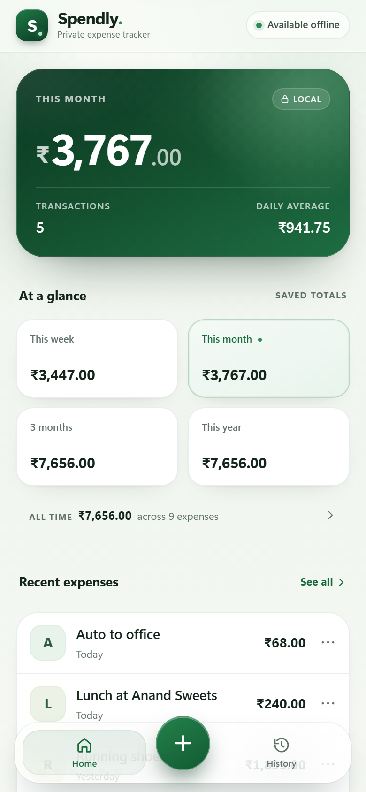
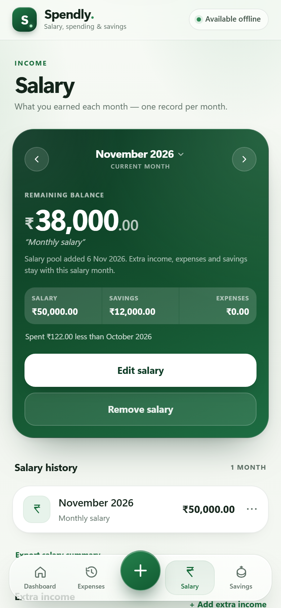
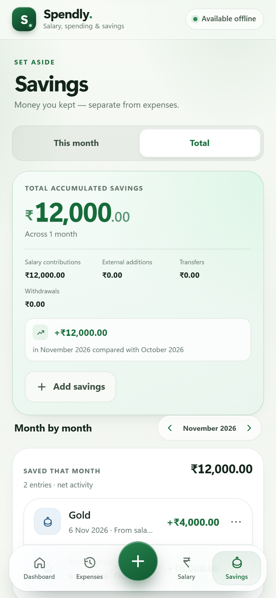
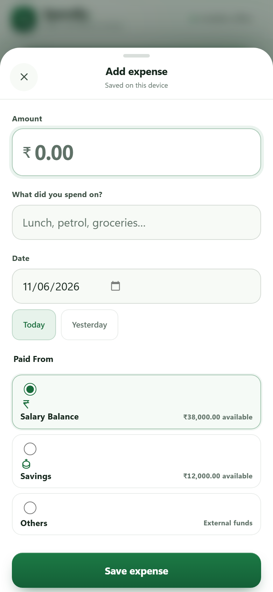

# Spendly

A private, offline-first salary, expense and savings tracker built with plain HTML, CSS and JavaScript. No build step, no account, no backend, no API keys.

<p align="center">
  
  
  
  
</p>

<p align="center"><em>Sample data shown. The interface is designed for iPhone and also works on desktop.</em></p>

## What changed in 3.2

Spendly grew from a single-page expense tracker into a personal finance tracker with **four dedicated pages** and one financial rule:

> **Salary pool remaining = salary − allocated expenses − savings contributions − salary-balance transfers**

- **Dashboard, Expenses, Salary and Savings are separate pages**, connected by a persistent four-tab Liquid Glass dock. A floating add button records expenses from anywhere.
- **Manual salary pools.** Each salary has a stable record ID; the newest salary becomes the active pool. Expenses and savings contributions link to that salary regardless of transaction date.
- **Paid From selection.** Expenses can use the active salary or accumulated Savings. Savings-funded expenses create linked withdrawals atomically and cannot exceed available savings.
- **Typed savings ledger.** Contributions and salary-balance transfers are credits; expense-linked withdrawals are debits. No savings transaction becomes an expense.
- **Optional leftover transfer.** After a new salary is added, Spendly asks before transferring a previous pool’s positive balance into Savings. Deferred balances remain available to transfer later.
- **IndexedDB moved from v2 to v3** with additive relationship indexes and a one-time timestamp-based allocation migration. Existing records remain intact; ambiguous legacy records are flagged for review.
- **The dashboard keeps calendar-based expense analytics** while salary balances follow explicit pool allocations.
- **Money arithmetic uses integer paise** internally, so salary, savings and remaining balances never drift through floating-point addition.
- **Backups are version 4** and include allocation IDs, savings types and withdrawal links. Version 3 and expense-only backups remain supported.
- **All earlier features are preserved:** weekly/monthly/three-month/yearly totals, daily average, recent expenses, searchable history, editing, deletion with Undo, CSV export, JSON backup/restore and offline-first PWA behaviour.

## Features

### Dashboard
- This month's spending hero with transaction count and daily average.
- Monthly overview card: salary, expenses, savings and remaining balance for any selected month.
- Previous/next month navigation that recalculates from that month's records only.
- Shortcuts to Salary and Savings.
- Weekly bar chart (Monday–Sunday), period totals (week, month, rolling 3 months, year) and all-time total.
- Recent expenses, Install tip and offline state.

### Expenses
- Add, edit and delete expenses with Indian Rupee formatting (`en-IN`, ₹).
- Month-grouped history with subtotals, search across description/date/month/amount, and Undo after delete.
- CSV export (expenses only) for Excel or Google Sheets.
- Version 4 JSON backup and validated atomic restore with a safety copy and Undo.

### Salary
- One salary record per month, entered by hand in ₹.
- The primary amount is the selected salary pool’s remaining balance; the breakdown is Salary, Savings and Expenses.
- Expenses and contributions follow salary record IDs, even when their dates fall in another calendar month.
- **Month navigator** at the top: previous/next arrows, the selected month and year, and a tap-to-open month + year picker for jumping anywhere.
- **Current month** shortcut appears as soon as you look at another month, and returns you to today in one tap.
- A small slide animation on the amount when the month changes; Left/Right arrow keys move between months when the navigator has focus.
- After a new salary, an optional prompt offers to transfer the previous pool’s positive remaining balance into Savings.
- Notes, salary history, edit and remove (with confirmation and Undo).
- A month without a salary is shown as **Not configured**, never as a fake balance.
- Navigating never writes a record: browsing future or empty months cannot create a salary.

### Savings
- **This month** tab: net activity, contributions, transfers, withdrawals and transaction history.
- **Total** tab: accumulated balance, lifetime contributions/transfers/withdrawals, month-by-month navigation and history.
- Contributions debit the active salary pool. Withdrawals stay linked to their expenses and cannot make Savings negative.
- Deleting a savings entry asks for confirmation and still offers Undo.
- Savings never appear in expense history, expense totals or CSV exports.

### Platform
- Installable PWA with offline launch, iPhone Home Screen support and app shortcuts.
- Local-first: all data stays in the browser for this site address. Nothing is uploaded.
- iPhone-safe layout: safe areas, 44 px+ touch targets, native-feeling sheets, no horizontal overflow.

## Project structure

```text
Spendly/
├── index.html                 # Four pages, accessible markup, SVG icon sprite, sheets
├── css/
│   └── app.css                # Liquid Glass design system and responsive layout
├── js/
│   ├── core.js                # Pure dates, month keys, paise, validation, finance rules
│   ├── db.js                  # The only IndexedDB adapter (v1 → v3 schema)
│   ├── repository.js          # Expense, Salary and Savings repositories + migration
│   └── app.js                 # UI rendering and interaction (never touches IndexedDB)
├── sw.js                      # Precache + offline shell + safe update flow
├── manifest.json              # PWA metadata, icons and shortcuts
├── netlify.toml               # Static publish config and cache/security headers
├── icons/                     # App icons (180, 192, 512, maskable)
├── screenshots/               # Documentation screenshots
├── context/                   # Append/update-only project context for future agents
│   ├── architecture.md
│   ├── data-model.md
│   ├── design-system.md
│   ├── testing.md
│   └── roadmap.md
├── memory.md                  # Append/update-only project memory (decisions, issues, fixes)
├── tests/
│   ├── server.mjs             # Zero-dependency local static server
│   ├── e2e.mjs                # Playwright browser suite (13 scenarios)
│   └── unit/
│       ├── core.test.mjs
│       ├── repository.test.mjs
│       ├── finance.test.mjs
│       └── finance-repository.test.mjs
├── package.json               # Test scripts only; the app needs no dependencies
├── .gitignore
└── README.md
```

## Running the project locally

The app is static, but it uses ES modules and a service worker. **Do not open `index.html` by double-clicking it** — open it through a local web server.

### Fastest option (Node.js 20+)

```bash
npm start
```

Then open **http://localhost:4173**. The included server has no dependencies and serves the project with the correct MIME types. A service worker is allowed on `localhost`, so offline testing works here.

### VS Code / Live Server

1. Open the `Spendly` folder in VS Code.
2. Install the **Live Server** extension (Ritwick Dey), if needed.
3. Right-click `index.html` → **Open with Live Server**.
4. Open the address it prints, usually `http://127.0.0.1:5500`.

For installation on an actual iPhone, the site must be served over **HTTPS** (Netlify does this) or from `localhost` on a computer.

## Testing

### Unit tests (no install needed)

```bash
npm test
```

56 tests cover:

- calendar bounds, Monday-start weeks, rolling three-month windows and leap/real-date validation;
- month keys (validation, derivation, shifting across year boundaries, month length);
- integer-paise conversion and exact `0.1 + 0.2` style arithmetic;
- expense, salary and savings validation and record normalisation;
- the monthly rule: only that month's expenses and savings are deducted, nothing carries forward, negative balances stay exact;
- salary-pool math by allocation ID across calendar months, plus separate savings credits and withdrawals;
- salary repositories: one record per month, duplicate rejection (including the IndexedDB constraint path), independent edits, Undo and backup replacement;
- savings repositories: date-derived months, editing across months, deletion/restore, totals and per-month grouping;
- legacy `localStorage` migration idempotency, duplicate handling and verification failure.

### Browser end-to-end tests

One-time setup:

```bash
npm install
npx playwright install chromium
```

Run:

```bash
npm run test:e2e
```

The suite starts its own server and verifies:

1. Existing `localStorage` expenses migrate once, keep their ids/timestamps, and survive a reload without duplicates.
2. Add, edit, delete, undo, search, CSV export, JSON backup, invalid restore rejection and valid restore with undo.
3. The service worker caches every shell asset; the app relaunches offline, then adds/edits/deletes/searches/exports/restores offline, and reopens in a new tab while still offline.
4. Expenses and the cached app shell survive a **full browser restart** using a persistent browser profile, including an offline reload afterwards.
5. Salary + savings + expenses produce the expected remaining balance, and that balance updates after adding, editing and deleting each record type.
6. Salary months stay independent; duplicates are blocked with a visible error; future months can be selected.
7. The Salary month navigator: the picker jumps to a month, **Current month** returns, navigating creates no records, and a sheet reopened mid-close still opens on screen.
8. A month with no salary shows **Not configured / —** instead of a balance, and overspending shows a clear negative balance.
9. Savings history spans months, month-by-month navigation works, growth is computed against the previous month, and savings never appear in expenses.
10. A hand-built **version 1 IndexedDB database** upgrades to v3 with its expense intact, and salary/savings stores are created alongside it.
11. Salary and savings can be added and read while fully offline, then survive an offline reload.
12. The iPhone install hint appears and stays dismissed after reload.
13. Layouts at 320 px mobile, 390 px mobile and 1440 px desktop, without horizontal overflow.
14. Screenshots are regenerated in `screenshots/`.

That is 17 browser scenarios plus 56 unit tests.

The run finishes with a pass/fail summary and fails if the browser console reports an error. Temporary test files go to `test-results/` (ignored by Git).

### Manual testing checklist

Automation cannot cover real iOS behaviour. Before shipping, check:

- [ ] Install the previous release with a few real expenses, download a backup, deploy this version, then open it. Confirm every expense is present, totals match, and no duplicates appear after two reloads.
- [ ] In DevTools → Application → Storage, confirm `spendly_expenses_v1` remains untouched, the `spendly` database is version 3, and the existing records survive the upgrade.
- [ ] Add a salary for September, October and November. Edit one month and confirm the other two do not change.
- [ ] Try to create a second salary for the same month; confirm the error appears in the sheet and nothing is saved.
- [ ] Add two savings entries this month and one for a previous month. Confirm This month shows only this month, Total shows all months, and growth matches the difference.
- [ ] Add a ₹1,000 expense dated next month while the current salary is active; confirm it reduces that pool, not the calendar month’s salary.
- [ ] Add a salary for the new month and confirm new expenses use it while existing expenses stay linked to the old pool.
- [ ] Add a contribution, transfer a previous positive balance, then spend from Savings; verify the three ledger types and balances.
- [ ] Try spending more than the Savings balance; confirm the expense is blocked without a salary fallback.
- [ ] Edit the salary to ₹60,000 and confirm the remaining balance rises by ₹10,000.
- [ ] Navigate the dashboard overview to a previous month and confirm it shows that month's salary, expenses and savings only.
- [ ] Select a month with no salary and confirm **Not set / —** is shown, not a negative or zero balance.
- [ ] Make expenses exceed salary and confirm a red negative remaining balance with an explanatory note.
- [ ] Go offline (DevTools → Network → Offline) after one online load. Add and edit a salary, add/edit/delete savings, reload, and confirm everything persists.
- [ ] On an iPhone in Safari, tap **Share → Add to Home Screen**, open Spendly from the icon, and check the notch/Dynamic Island spacing and bottom safe area behind the dock.
- [ ] In standalone mode, open each sheet with the keyboard visible and confirm the dock never covers the save button or fields.
- [ ] Test VoiceOver labels for the four dock tabs, the add button, month steppers, period tiles, expense/salary/savings rows and the savings tabs.
- [ ] Enable Reduce Motion and Reduce Transparency in iOS Accessibility settings and confirm the app remains usable without blur or animation.
- [ ] Test text at a large accessibility size (or 200% browser zoom) and confirm no controls are clipped.
- [ ] Deploy an update with a bumped cache version and confirm the “new version is ready” banner appears, then Refresh applies it.
- [ ] Try CSV/JSON downloads in iOS Safari and confirm they can be saved to Files; test restoring the JSON through the file picker.

## Offline behaviour

The service worker (`sw.js`) precaches the app shell during install:

- `index.html`, `css/app.css`, all JS modules, `manifest.json` and all icons.
- Navigation requests are answered from the cached shell, so the HTML always matches the cached JS/CSS generation.
- Local static assets are served cache-first; unknown same-origin GETs fall back to the network and are cached when successful.
- Cross-origin requests and non-GET requests are not intercepted.
- A new service worker waits instead of taking over immediately. Spendly shows a **Refresh** banner, then the new worker activates and old `spendly-*` caches are deleted.
- The service worker never opens IndexedDB. Updating the app therefore cannot erase expenses, salary or savings.

Salary and savings are written through the same local repositories as expenses, so every feature works offline exactly as it does online. There are no network calls in any finance path.

**When you change any cached asset (HTML, CSS, JS, manifest, icons), bump `CACHE_VERSION` in `sw.js`.** The current generation is `v10`. Netlify already serves `sw.js` with `Cache-Control: no-cache`.

Offline use requires **one successful online load first**, over HTTPS or localhost. After that, the app and its local data work without a connection.

## Where data is stored

- **Primary storage:** IndexedDB database `spendly`, **version 3**.
  - `expenses` — keyed by `id`, indexes `by_date`, `by_createdAt`, `by_date_createdAt`, `by_salaryRecordId`, `by_paymentSource`.
  - `salaries` — keyed by `id`, **unique** index `by_monthKey`, plus `by_createdAt`. One salary per `YYYY-MM`.
  - `savings` — keyed by `id`, indexes `by_monthKey`, `by_date`, `by_date_createdAt`, `by_type`, `by_salaryRecordId`, unique sparse `by_expenseId`.
  - `meta` — keyed by `key`, used for legacy migration markers and unresolved allocation review IDs.
- **Legacy storage:** `localStorage["spendly_expenses_v1"]`. It is read during migration and deliberately **left untouched**.
- **Small UI preferences** (such as the dismissed install tip) use separate `localStorage` keys; they are not financial data.

### Record shapes

```json
// expenses
{
  "id": "8d0d5e4a-…",
  "amount": 240,
  "description": "Lunch",
  "date": "2026-11-04",
  "createdAt": "2026-11-04T08:20:00.000Z",
  "updatedAt": "2026-11-04T08:20:00.000Z"
}

// salaries
{
  "id": "b0f3…",
  "monthKey": "2026-11",
  "amount": 50000,
  "amountPaise": 5000000,
  "notes": "Monthly salary",
  "createdAt": "2026-11-01T04:00:00.000Z",
  "updatedAt": "2026-11-01T04:00:00.000Z"
}

// savings
{
  "id": "2c91…",
  "monthKey": "2026-11",
  "amount": 4000,
  "amountPaise": 400000,
  "date": "2026-11-04",
  "description": "Gold",
  "createdAt": "2026-11-04T09:10:00.000Z",
  "updatedAt": "2026-11-04T09:10:00.000Z"
}
```

`amount` is the display value in rupees; `amountPaise` is the integer source used for every calculation. Both are always derived together on save, so they cannot drift. `monthKey` on a savings record is derived from `date`; calculations prefer the date.

### Salary-pool and savings calculation rules

- New expenses funded by Salary Balance link to the latest created salary record. Transaction date does not change allocation.
- Savings contributions link to the active salary pool. Transfers debit their originating salary and credit Savings.
- Savings-funded expenses have one linked withdrawal; the pair is created, edited and deleted atomically.
- Salary remaining = salary − linked salary-funded expenses − linked contributions − balance transfers.
- Savings balance = contributions + salary transfers − expense-linked withdrawals.
- If no salary exists for a selected month, the Salary page shows **No salary pool** and no balance.
- A negative remaining balance is displayed clearly in red with an explanation.
- All sums use integer paise.

### Database upgrade (v1/v2 → v3)

The upgrade runs inside IndexedDB's `onupgradeneeded` transaction:

1. Existing `expenses` and `meta` stores are left exactly as they are.
2. Salary and savings stores are created only if missing; v3 adds indexes without clearing the stores.
3. If anything fails, the transaction is aborted, so IndexedDB rolls back to the v1 schema instead of leaving a half-created database.
4. Nothing is cleared. A separate one-time data migration adds allocation fields to older records.

The allocation migration assigns each legacy record to the most recently created salary at its `createdAt`. Records without a reliable match keep their original values, remain unallocated and appear as **Source needs review**. No transaction is charged to a newer pool by guesswork.

The browser suite builds a real v1 database before loading the app and asserts the expense survives the upgrade and appears in the UI.

### Automatic legacy migration

Separately from the schema upgrade, the existing expense migration still runs once:

1. Spendly checks for the `migration:localStorage:v1` marker in `meta`; if present, it stops.
2. Otherwise it reads `spendly_expenses_v1`, validates every record, preserves ids and recovers `createdAt` from the old timestamp-based id where possible.
3. Records are written by id, so a repeated run cannot duplicate them; existing IndexedDB records win.
4. Spendly reads the records back and verifies every id exists before writing the completion marker.
5. The original `localStorage` value is never modified.

## Exporting and restoring backups

Open **Expenses → Your data**.

- **Export CSV** downloads expenses only (date, description, amount) with a UTF-8 BOM so Excel reads ₹ correctly. Salary and savings are intentionally excluded.
- **Download backup** downloads a JSON file stamped `version: 4` containing expenses, salary pool IDs, typed savings movements and linked withdrawals.
- **Restore backup** validates the whole file before asking for confirmation. It downloads a safety copy of the current data, then replaces expenses and — when present in the file — salary and savings too. A restore can be undone immediately from the toast.
- Version 3 and expense-only backups still restore. Legacy records are assigned by timestamps; optional collections absent from a backup remain untouched.
- Restore validates salary references, withdrawal links, duplicate withdrawals and nonnegative Savings, then updates the related collections in one IndexedDB transaction.
- Invalid JSON, wrong shapes, corrupt records, duplicate salary months and files over 10 MB are rejected without changing any data.

Restoring **replaces** the included collections; it does not merge. The safety copy and Undo make that reversible.

## Install on iPhone

1. Open the deployed HTTPS address in **Safari** (not an in-app browser).
2. Tap **Share** → **Add to Home Screen**.
3. Keep the name **Spendly**, then tap **Add**.
4. Launch Spendly from the Home Screen. It opens in standalone mode with the correct status-bar, notch and bottom safe-area spacing.
5. Open it online once so the service worker installs the shell. After that, it opens offline.

On supported desktop/Android browsers, Spendly may also offer an **Install app** prompt after the first record.

## Deploy to Netlify

The repository already includes `netlify.toml`:

- Publish directory: `.` (the project root)
- Build command: **none**
- `sw.js` is served with `Cache-Control: no-cache`
- Manifest, JS/CSS and icon caching headers are set

### First deployment

1. Create an empty GitHub repository named `spendly` (do not initialise it with a README).
2. In this folder:

```bash
git status
git add README.md context css index.html js package.json package-lock.json screenshots sw.js tests memory.md
git commit -m "Add salary pools and source-aware savings ledger"
git remote add origin https://github.com/<your-account>/spendly.git
git push -u origin main
```

If an `origin` already exists, skip `git remote add` and just push. This repository currently points at `https://github.com/CodeOfMugiwara/spendly.git`.

3. In Netlify: **Add new project → Import an existing project → GitHub**, choose the repository.
4. Leave **Build command** blank.
5. Set **Publish directory** to `.`.
6. Deploy. No environment variables or secrets are required.

### Updating an existing Netlify site

1. Bump `CACHE_VERSION` in `sw.js` whenever you change cached assets (currently `v10`).
2. Commit and push to the branch Netlify watches:

```bash
git status
git add README.md context css index.html js package.json package-lock.json screenshots sw.js tests memory.md
git commit -m "Update Spendly salary and savings ledger"
git push origin main
```

3. Netlify deploys automatically. If auto-publishing is off, use **Deploys → Trigger deploy → Deploy site**.
4. Open the site online once and hard-reload if needed. If the update banner appears, tap **Refresh**.

The site URL is in Netlify under **Domain management**. Reinstalling from the Home Screen is not necessary for normal updates; the service worker refreshes the shell.

## Architecture and future cloud sync

```text
UI (js/app.js)
      │  only calls repository methods
      ▼
ExpenseRepository · SalaryRepository · SavingsRepository (js/repository.js)
      │  validation, stable ids, timestamps, duplicate rules, atomic replace
      ▼
IndexedDBExpenseStore · IndexedDBSalaryStore · IndexedDBSavingsStore (js/db.js)
      │  the only IndexedDB-aware code
      ▼
Browser IndexedDB (spendly v3)
```

Pure date/month/paise/finance rules live in `js/core.js` and are shared by the UI and tests. Each repository owns one store, and the UI never knows which one to call for a calculation: it asks `computeMonthlyFinance()` for the month.

This structure intentionally leaves a seam for a future remote adapter. Records already have stable ids and `createdAt` / `updatedAt`, and the UI has no knowledge of IndexedDB. A future phase can add a remote store or a sync-aware repository without rewriting the interface. **No sync engine, queue or authentication exists today**, by design.

## Project memory and context

- [`memory.md`](memory.md) — append/update-only log of every feature, decision, issue and fix.
- [`context/`](context/) — deeper append/update-only documents for architecture, data model, design system, testing and roadmap.

Future agents should read `memory.md` first, then the relevant context file, before changing the app. Both are maintained as append-or-update logs: existing entries are never overwritten or deleted.

## Limitations and privacy

- **Local only.** No accounts, login, cloud sync, Supabase/Firebase, or API keys. Data does not move between devices.
- **One origin, one browser.** Changing from a `*.netlify.app` URL to a custom domain creates a new storage origin; export a backup before changing domains and restore it on the new one.
- **Clearing browser/site data deletes everything.** So can removing the installed app's website data or using private browsing. Spendly requests persistent storage where supported, but browsers can still evict data.
- **Backups are essential.** Download a JSON backup regularly.
- **Offline requires a first online visit.** The service worker only exists after one successful load over HTTPS/localhost.
- **Restore replaces, it does not merge.** Use it to restore a full backup, with the safety copy and Undo as guard rails.
- **One salary per month.** That is enforced by a unique IndexedDB index; a duplicate is rejected with a clear message.
- **Savings dates cannot be in the future.** A savings entry records money already set aside. Salary months, by contrast, may be past or future.
- **The salary month picker covers six years back and three years forward** relative to the current year. Older records still display correctly if restored from a backup.
- **No live cross-tab sync.** A second tab sees changes after reload.
- **Light theme only.** The design is optimised for Spendly's white-and-forest identity and does not currently ship a dark theme.
- **Modern browser needed.** The interface uses native `<dialog>`, `:has()` and `backdrop-filter`; iOS 15.4+ and current Safari/Chrome/Edge are supported.
- **Large histories render as one list.** This is intentionally simple for a personal tracker; there is no virtualisation.
- **CSV/JSON downloads on iOS** may open the Files share sheet instead of saving directly, depending on Safari settings.
- **Your source code is public if the GitHub repository is public.** Do not put personal financial data, credentials or keys in the repository. Records live only in the browser, not in the repo.

## License

No license file is included. Add one if you plan to distribute the project.

