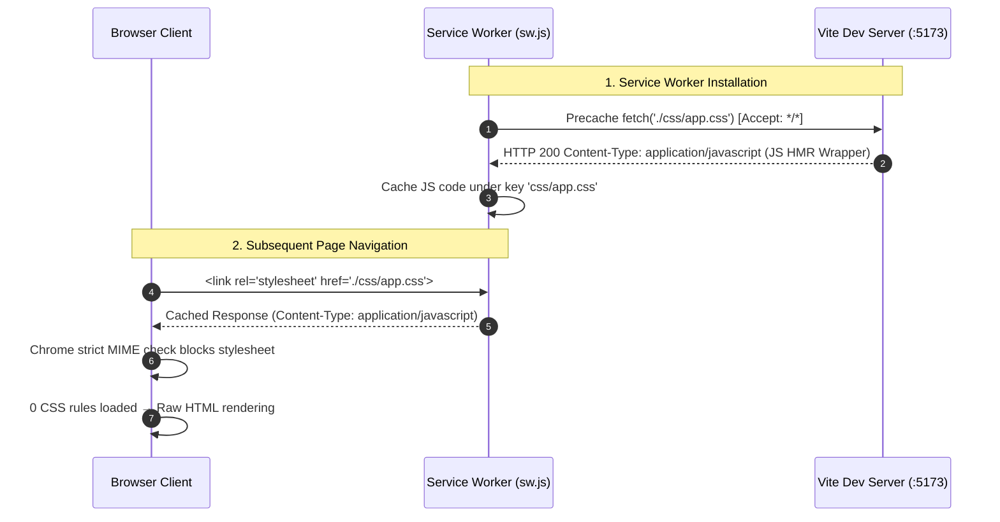

# Incident Post-Mortem: Unstyled UI & Poisoned Service Worker Cache

**Date:** 8 November 2026  
**Status:** Resolved & Permanently Guarded  
**Related Commits:** [`0b325ca`](file:///d:/Spendly/sw.js#L15), [`6596acc`](file:///d:/Spendly/sw.js#L42)

---

## 1. Symptoms & User Impact
When opening the Spendly local development server at `http://127.0.0.1:5173/`, the application rendered as raw, unstyled HTML:
- Typography defaulted to serif (Times New Roman).
- Buttons and inputs reverted to native browser styling.
- Unconstrained SVG icons expanded to massive black shapes dominating the viewport.
- An intrusive update banner appeared: `A new version of Spendly is ready. [Refresh]`.
- Clicking `Refresh` simply reloaded the same broken layout indefinitely.

---

## 2. Root Cause Analysis

### Mechanism of Failure


1. **Vite Development CSS Module Transformation**:
   - In Vite dev mode (`vite`), files are compiled on the fly.
   - When Vite receives a request for a `.css` file:
     - If the `Accept` header contains `text/css`, Vite serves raw CSS text with `Content-Type: text/css`.
     - If the `Accept` header is `*/*` (default for `fetch()`), Vite treats it as a JavaScript module import for Hot Module Reloading (HMR) and responds with `Content-Type: application/javascript; charset=utf-8` containing code like `import { createHotContext } from '/@vite/client'`.
2. **Service Worker Precache Cache Poisoning**:
   - In `sw.js`, `cache.addAll(APP_SHELL.map(...))` fetched `./css/app.css` using default `fetch()` headers (`Accept: */*`).
   - The Service Worker stored the JavaScript HMR code into Cache Storage under the key `./css/app.css`.
3. **Strict Browser MIME-Type Enforcement**:
   - When Chrome loaded `<link rel="stylesheet" href="./css/app.css">`, `sw.js` intercepted the request and returned the cached JavaScript payload.
   - Modern browsers enforce strict MIME type checking for stylesheets. Seeing `Content-Type: application/javascript`, Chrome dropped the stylesheet entirely:
     `Refused to apply style from 'http://127.0.0.1:5173/css/app.css' because its MIME type ('application/javascript') is not a supported stylesheet MIME type, and strict MIME checking is enabled.`
   - Result: Exactly 0 CSS rules were applied to the DOM.
4. **Stale Service Worker Lock & Refresh Loop**:
   - The previous service worker generation was active without `self.skipWaiting()`.
   - The new worker remained stuck in the `waiting` state, which caused `showUpdateIfWaiting()` to trigger the banner. Clicking Refresh reloaded the page through the poisoned cache.

---

## 3. The 4-Layer Resolution Strategy

To ensure this class of failure cannot recur in development, staging, or production, four independent layers of protection were implemented:

### Layer 1: Vite Development Server Middleware
**File:** [`vite.config.js`](file:///d:/Spendly/vite.config.js#L38-L54)
```javascript
function devCssMiddleware() {
  return {
    name: 'spendly-dev-css',
    configureServer(server) {
      server.middlewares.use((req, res, next) => {
        if (req.url && (req.url.endsWith('.css') || req.url.includes('.css?'))) {
          const accept = req.headers['accept'] || '';
          if (!accept.includes('application/javascript') && !accept.includes('text/javascript')) {
            req.headers['accept'] = 'text/css,*/*;q=0.1';
          }
        }
        next();
      });
    }
  };
}
```
*Guarantees Vite dev server always receives `Accept: text/css` and returns raw CSS.*

### Layer 2: Service Worker Precache Headers & Localhost Network-First
**File:** [`sw.js`](file:///d:/Spendly/sw.js#L42-L168)
- Precache fetch for CSS explicitly sets `headers: { 'Accept': 'text/css,*/*;q=0.1' }`.
- On `localhost` / `127.0.0.1`, `sw.js` prioritizes live network fetch over cache, using cache only as an offline fallback.
- Cache storage strictly validates that `Content-Type` includes `text/css` before storing any `.css` response; invalid responses are rejected and purged.
- Cache namespace was bumped to `spendly-shell-v27`, and `self.skipWaiting()` was added to `install`.

### Layer 3: Client-Side Self-Healing Guard in HTML
**File:** [`index.html`](file:///d:/Spendly/index.html#L18-L52)
A lightweight inlined script in `<head>` executes before body rendering:
```javascript
window.addEventListener('DOMContentLoaded', function() {
  var sheet = link ? link.sheet : null;
  var hasRules = false;
  try {
    hasRules = Boolean(sheet && sheet.cssRules && sheet.cssRules.length > 0);
  } catch (e) { hasRules = false; }
  if (!hasRules && 'serviceWorker' in navigator && navigator.serviceWorker.controller) {
    purgeAndRecover(); // clears all caches, unregisters workers, reloads cleanly
  }
});
```

### Layer 4: Silent Service Worker Activation
**File:** [`js/app.js`](file:///d:/Spendly/js/app.js#L2697-L2704)
Updated `showUpdateIfWaiting()` so that unauthenticated / login views automatically activate waiting workers silently without prompting the user with a banner.

---

## 4. Verification
- **Dev Server**: Navigating to `http://127.0.0.1:5173/` loads 496 active CSS rules.
- **Preview Server**: `npm run preview` on `http://127.0.0.1:4173/` loads clean styles and 0 console errors.
- **E2E Suite**: 38/38 checks pass including offline PWA scenarios.
